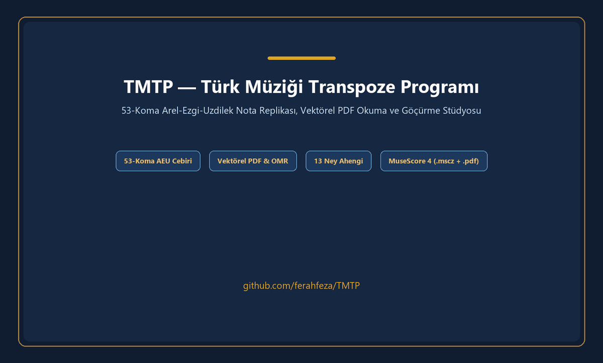
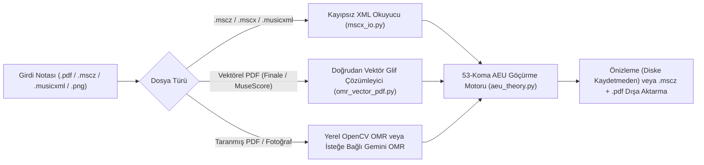

# TMTP — Türk Müziği Transpoze ve Nota Replikası Programı

**TMTP (`MakamNotaApp`)**, bilgisayarda kurulu **MuseScore 4** altyapısını kullanarak verilen bir Türk müziği notasının (`.pdf`, `.png`, `.jpg`, `.mscz`, `.mscx`, `.musicxml`, `.mxl`, `.json`) **bire bir replikasını (`0 koma`)** veya **53-Koma Arel-Ezgi-Uzdilek (AEU)** ses sisteminde istenen herhangi bir karar perdesine ya da **Ney ahengine** transpozesini (göçürmesini) üreten bağımsız masaüstü (`PyQt5`) ve komut satırı (`CLI`) uygulamasıdır.

> *English Summary:* **TMTP** is a standalone desktop & CLI studio for **53-EDO Turkish Makam Music (Arel-Ezgi-Uzdilek)** score replication, vector/raster OMR, and exact microtonal transposition (by intervals/commas, tonic *perde*, or 13 *Ney ahenk* tunings), exporting publication-ready `.mscz` and `.pdf` scores via MuseScore 4.

---

## Tanıtım Videosu

<div align="center">
  <a href="https://github.com/ferahfeza/TMTP/raw/main/assets/tmtp_tanitim.mp4">
    
  </a>
  <p>
    <em>Yukarıdaki canlı önizleme doğrudan oynar; <strong>53-EDO Şevkefzâ sesli tam çözünürlüklü sürüm</strong> için <a href="https://github.com/ferahfeza/TMTP/raw/main/assets/tmtp_tanitim.mp4"><strong>🎬 Sesli Tanıtım Videosunu Aç / İndir (MP4)</strong></a> bağlantısına tıklayabilirsiniz.</em>
  </p>
</div>

---

## Öne Çıkan Özellikler

### 1. Tam 53-Koma Arel-Ezgi-Uzdilek (AEU) Göçürme Motoru
- **Üç Farklı Göçürme Seçim Modu:**
  1. **Ses / Koma Aralığı:** Bire bir replika (`0 koma`), `±1 tam ses (±9 koma)`, yarım ses (`±4 koma`), tam dörtlü (`±22 koma`), tam beşli (`±31 koma`), `±1 oktav (±53 koma)` veya özel diyatonik adım / koma girişi.
  2. **Karar Perdesi $\rightarrow$ Hedef Perde:** *Kaba Çargâh (Do4)* perdesinden *Nevâ (Re5)* perdesine kadar 12 temel perde arasında doğrudan göçürme (örn. *Acemaşîrân Fa4 $\rightarrow$ Rast Sol4*).
  3. **Ney Ahenkleri (`Elimdeki Ney` $\rightarrow$ `İcra Edilecek Ahenk`):** Ana ve *Mâbeyn* (ara) neyler dahil **13 ney ahengi** arasında hem yukarı hem aşağı çift yönlü göçürme ve tek tıkla **`±1 Oktav`** bölge kaydırma.
- **Otomatik ve Düzenlenebilir Donanım Tablosu:** Kaynak makam donanımından yeni makam donanımı (9 standart AEU değiştirici işareti: `-8, -5, -4, -1, 0, +1, +4, +5, +8` koma) otomatik hesaplanır; kullanıcı isterse tablodan her perdeyi ayrı ayrı düzenleyebilir.
- **Gerçek 53-EDO Mikrotonal Akort (`Cent`):** MuseScore `<Note><tuning>` alanına `1 koma ≈ 22.64 cent` hassasiyetinde gerçek Türk müziği frekans sapmalarını yazar.

### 2. Üç Katmanlı Nota Okuma (Vektör PDF, Dijital ve Görüntü OMR)


- **Doğrudan Vektörel PDF Çözümleyici (`omr_vector_pdf.py` — %100 Çevrimdışı, API Anahtarsız):**
  Finale (`Petrucci`, `Maestro`, `Engraver` + `TURKEY` AEU mikrotonal fontu) ve MuseScore/SMuFL (`Leland`, `Bravura`) kaynaklı vektörel PDF'leri görüntüye dönüştürmeden doğrudan glif, porte, kiriş, uzatma noktası, röpriz, `1.`/`2.` dolap (`Volta`), Segno (`𝄋`), AEU donanım ve **çok kıtalı güfte (`<Lyrics>`)** düzeyinde saniyenin altında çözümler.
- **Kayıpsız Dijital İşleme (`mscx_io.py`):** `.mscz`, `.mscx`, `.musicxml` ve `.mxl` dosyalarında tüm bağları, çarpmaları, güfteleri ve dolapları koruyarak göçürür.
- **Taranmış Görsel OMR (`omr_opencv.py` & `omr_gemini.py`):** Taranmış resim/fotokopi notalarda çevrimdışı OpenCV motoru veya isteğe bağlı kullanıcı Gemini API anahtarıyla çok-modlu okuma ve otomatik usûl/süre doğrulaması sunar.

### 3. Kullanıcı Dostu Masaüstü Stüdyosu (`gui_app.py`)
- **Kaydetmeden Canlı Önizleme:** `🔄 Transpoze Et ve Önizle` düğmesi kullanıcı klasörlerine hiçbir dosya yazmadan dönüştürülmüş notayı yan yana karşılaştırmalı ekranda gösterir.
- **Pencereye Tam Sığdırma (`Fit Page` / `Fit Width`):** İlk açılışta ve tam ekran geçişlerinde hem kaynak hem hedef nota kaydırma çubuğu gerektirmeden pencereye tam sığar (`Ctrl + Fare Tekerleği` ile yakınlaştırma destekli).
- **İsteğe Bağlı Kaydetme ve Çıkış Koruması:** Yalnızca `💾 Kaydet (.mscz + .pdf)...` seçildiğinde diske kayıt yapılır; kaydedilmemiş çalışma varken program kapatılmak istendiğinde uyarı verilir.

---

## Desteklenen 13 Ney Ahengi Tablosu

| İndeks | Ney / Ahenk Adı | Dügâh (`La4`) Karşılığı | Bolâhenk Nısfiye'ye Göre |
| :---: | :--- | :--- | :---: |
| `0` | **Bolâhenk Nısfiye** | Hüseynî (`Mi4`) — *Nevâ = 440 Hz* | `0 adım, 0 koma` |
| `1` | **Bolâhenk–Süpürde Mâbeyni** | Hisar (`Mi♭4`) | `-1 adım, -5 koma` |
| `2` | **Süpürde Ney** | Nevâ (`Re4`) | `-1 adım, -9 koma` |
| `3` | **Müstahsen Ney** | Nim Hicaz (`Do#4`) | `-2 adım, -14 koma` |
| `4` | **Yıldız Ney** | Çargâh (`Do4`) | `-2 adım, -18 koma` |
| `5` | **Kız Ney** | Bûselik (`Si3`) | `-3 adım, -22 koma` |
| `6` | **Kız–Mansur Mâbeyni** | Dik Kürdî (`Si♭3`) | `-3 adım, -26 koma` |
| `7` | **Mansur Ney** | Dügâh (`La3` — *Piyano Ahengi*) | `-4 adım, -31 koma` |
| `8` | **Şah–Mansur Mâbeyni** | Zirgüle (`Sol#3`) | `-5 adım, -36 koma` |
| `9` | **Şah Ney** | Rast (`Sol3`) | `-5 adım, -40 koma` |
| `10` | **Dâvud Ney** | Irak (`Fa#3`) | `-6 adım, -45 koma` |
| `11` | **Dâvud–Bolâhenk Mâbeyni** | Acemaşîrân (`Fa3`) | `-6 adım, -49 koma` |
| `12` | **Ana Bolâhenk Ney** | Hüseynîaşîrân (`Mi3` — *-1 Oktav*) | `-7 adım, -53 koma` |

---

## Kurulum Gereksinimleri

1. **MuseScore 4:** Bilgisayarınızda [MuseScore 4](https://musescore.org/) kurulu olmalıdır (varsayılan Windows yolu `C:\Program Files\MuseScore 4\bin\MuseScore4.exe` otomatik algılanır; farklı bir yoldaysa **⚙ Ayarlar** menüsünden seçilebilir).
2. **Python 3.10+** ve bağımlılık paketleri:
   ```powershell
   git clone https://github.com/ferahfeza/TMTP.git
   cd TMTP
   pip install -r requirements.txt
   ```

---

## Kullanım

### 1. Bağımsız Tek-Dosya Windows Uygulaması (`TMTP.exe` — Python Gerektirmez)
Python kurulu olmayan herhangi bir 64-bit Windows 10/11 bilgisayarda doğrudan çalıştırılabilir tek parça **`dist/TMTP.exe`** üretmek için:
```powershell
pip install pyinstaller
python build_exe.py
```
Üretilen `dist/TMTP.exe` dosyası tüm Python, PyQt5, PyMuPDF, OpenCV ve MSVC C/C++ çalışma zamanı bileşenlerini kendi içinde barındırır (yalnızca nota dizgisi/PDF üretimi için hedef bilgisayarda ücretsiz [MuseScore 4](https://musescore.org/) kurulu olması yeterlidir).

### 2. Kaynak Koddan Masaüstü Arayüzü
Windows'ta doğrudan **`Baslat.bat`** dosyasına çift tıklayın veya terminalden çalıştırın:
```powershell
python gui_app.py
```

### 3. Komut Satırı Arayüzü (`cli.py`)
```powershell
# Tüm hazır aralıkları, karar perdelerini ve 13 Ney ahengini listele:
python cli.py list-presets

# Bir PDF notasını 1 tam ses (+1 diyatonik adım, +9 koma) yukarı transpoze et:
python cli.py process --input "eser.pdf" --out-dir "./cikti" --steps 1 --commas 9

# Elimdeki Mansur Ney (7) ile Bolâhenk Nısfiye (0) ahenginde icra için transpoze et (+4 adım, +31 koma):
python cli.py process --input "eser.pdf" --out-dir "./cikti" --from-ahenk 7 --to-ahenk 0

# Acemaşîrân (3) kararlı bir eseri Rast (5) perdesine göçür:
python cli.py process --input "eser.mscz" --out-dir "./cikti" --from-perde 3 --to-perde 5

# Bire bir replika (.mscz + .pdf) üret:
python cli.py process --input "eser.pdf" --out-dir "./cikti" --steps 0 --commas 0 --no-midi
```

---

## Proje Yapısı

```text
TMTP/
├── Baslat.bat                  # Windows tek tıkla masaüstü başlatıcısı
├── build_exe.py                # Tek parça taşınabilir Windows .exe (dist/TMTP.exe) derleyicisi
├── gui_app.py                  # PyQt5 masaüstü kullanıcı arayüzü
├── cli.py                      # Komut satırı arayüzü
├── requirements.txt            # Python paket bağımlılıkları
├── assets/                     # Uygulama simgesi (.ico) ve tanıtım videosu (.mp4 / .gif)
├── makam_app/
│   ├── aeu_theory.py           # 53-Koma AEU arıza, donanım, perde, Ney ahengi ve cent cebiri
│   ├── score_model.py          # Nota veri modeli (ScoreDoc), usûl süre doğrulama ve göçürme
│   ├── mscx_io.py              # MuseScore 4 (.mscx) XML okuyucu, yazıcı ve kayıpsız göçürücü
│   ├── musescore_runner.py     # MuseScore4.exe arka plan derleme ve dışa aktarma sarmalayıcısı
│   ├── omr_vector_pdf.py       # Finale (Petrucci/TURKEY) ve SMuFL doğrudan vektörel PDF okuyucu
│   ├── omr_slicer.py           # Görüntü tabanlı notalar için porte satırı dilimleyici
│   ├── omr_opencv.py           # Çevrimdışı OpenCV optik nota tanıma motoru
│   ├── omr_gemini.py           # İsteğe bağlı Gemini API çok-modlu OMR motoru
│   ├── pipeline.py             # Uçtan uca yükleme, önizleme ve dışa aktarma iş hattı
│   └── config.py               # Yerel yapılandırma yönetimi
└── tests/
    └── test_makam_app.py       # Kapsamlı birim ve uçtan uca doğrulama testleri (pytest)
```

## Doğrulama Testleri
```powershell
pytest tests/test_makam_app.py -v
```

## Lisans
Bu proje [MIT Lisansı](LICENSE) altında sunulmaktadır.
